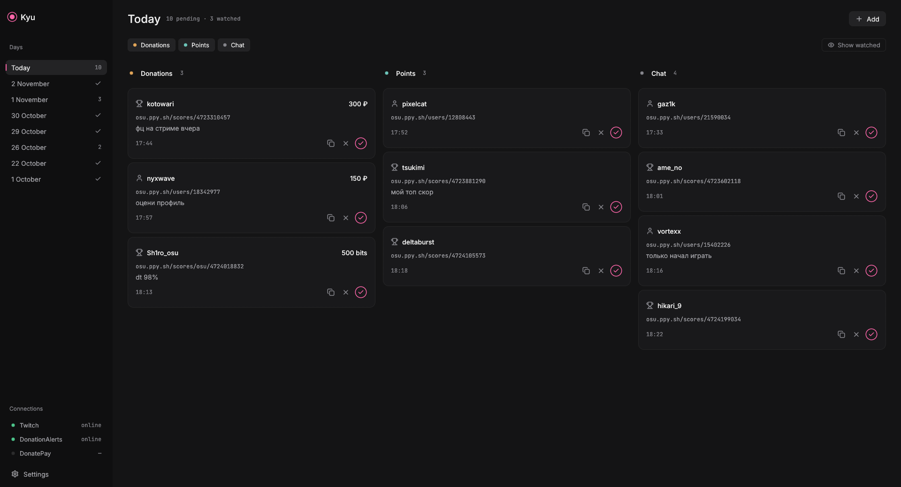
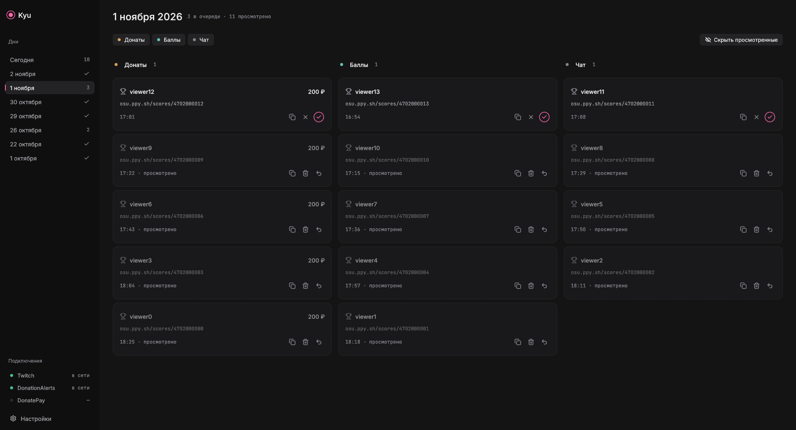
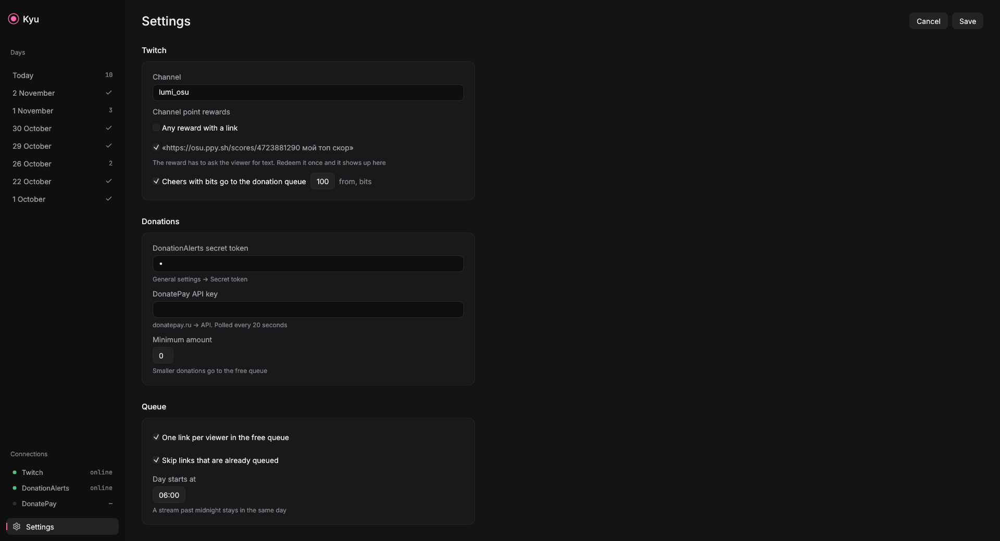

<p align="center"></p>

<h1 align="center">Kyu</h1>

<p align="center">A queue of osu! scores and profiles that viewers send to your Twitch stream<br>
<a href="README.ru.md">Читать на русском</a></p>



Kyu sits next to your stream and listens. When a viewer drops an osu! score or profile link in chat, redeems a channel points reward with one, or attaches one to a donation, it lands in one of three queues. You open it, watch it, and tick it off.

## What it does

- **Three queues.** Donations (DonationAlerts, DonatePay and cheers with bits), channel points rewards, and plain chat. Each one can be hidden, so you can run a stream where only points requests are shown.
- **Picks up links on its own.** `osu.ppy.sh/scores/…`, `osu.ppy.sh/users/…` and `osu.ppy.sh/u/…`, with or without `https://`.
- **Keeps every day.** Each stream day is saved to its own file. A month later you can open any day and see who you watched and who you skipped.
- **Nothing is deleted by default.** Turn on "Delete days older than" in settings if you want old days removed, 30 days by default.
- **Day boundary you choose.** The day starts at 06:00 by default, so a stream that runs past midnight stays in one day.
- **Spam guards.** One link per viewer in the free queue and no duplicate links. If someone pays for a link that already sits in the free queue, it moves to the paid queue instead of showing twice.
- **Manual add**, for links from Discord or anywhere else.
- **Russian and English** interface.

| Past days | Settings |
| --- | --- |
|  |  |

## Download

Grab the latest build from [Releases](https://github.com/sheynor43/kyu/releases/latest).

- **Windows:** `Kyu-1.0.0-windows-x64.exe`, a single file, no installer.
- **Linux:** `Kyu-1.0.0-x86_64.AppImage`, then `chmod +x Kyu-*.AppImage` and run it.

Windows SmartScreen may warn about an unsigned app. Click "More info", then "Run anyway".

## Setup

Open **Settings** in the bottom left.

### Twitch

Enter your channel name. Kyu reads chat anonymously, so it needs no login and no OAuth app.

For **channel points**, create a reward with "Require viewer to enter text" turned on. Twitch only shows redemptions with text in chat, and that is how Kyu sees them. Redeem the reward once yourself, and it appears in settings under "Channel point rewards", labelled with the text it was redeemed with. Tick the rewards that should count, or leave "Any reward with a link" on.

**Bits:** cheers of at least N bits (100 by default) go to the donation queue.

### DonationAlerts

Copy the secret token from DonationAlerts: *General settings → Secret token*, and paste it into settings. Send a test alert from the DonationAlerts dashboard with a link in the message to check it works.

### DonatePay

Create an API key on donatepay.ru in the API section and paste it. DonatePay allows one request every 20 seconds, so donations show up with up to a 20 second delay. Donations that come in while Kyu is closed are picked up on the next start.

### Minimum amount

Donations below the minimum go to the free queue instead of the paid one.

## Where data lives

| System | Folder |
| --- | --- |
| Windows | `%APPDATA%\kyu\data\` |
| Linux | `~/.local/share/kyu/` |

Each day is `days/YYYY-MM-DD.json`, settings are in `settings.json`. Tokens are stored there as plain text, so keep the folder private. "Open data folder" in settings takes you there.

## Building from source

You need Rust 1.85 or newer.

```sh
git clone https://github.com/sheynor43/kyu
cd kyu
cargo run --release
```

On Linux you also need the usual windowing headers, on Debian or Ubuntu: `libxkbcommon-dev libwayland-dev libxcb-render0-dev libxcb-shape0-dev libxcb-xfixes0-dev libgl1-mesa-dev`.

Tests: `cargo test`. Checks against the live Twitch and DonationAlerts servers: `cargo test -- --ignored`.

Releases are built by GitHub Actions on every `v*` tag, see `.github/workflows/release.yml`.

## Credits

- Interface built with [egui](https://github.com/emilk/egui)
- Icons from [Lucide](https://lucide.dev) (ISC)
- Fonts [Inter](https://rsms.me/inter/) and [JetBrains Mono](https://www.jetbrains.com/lp/mono/) (OFL)
- Design pass follows [unslop](https://github.com/heydamir/unslop) by Damir Sokolovsky (CC BY 4.0)

Kyu is not affiliated with osu!, ppy Pty Ltd, Twitch, DonationAlerts or DonatePay.

## License

MIT
