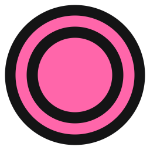
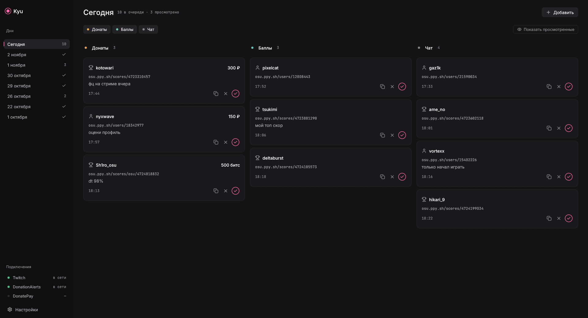
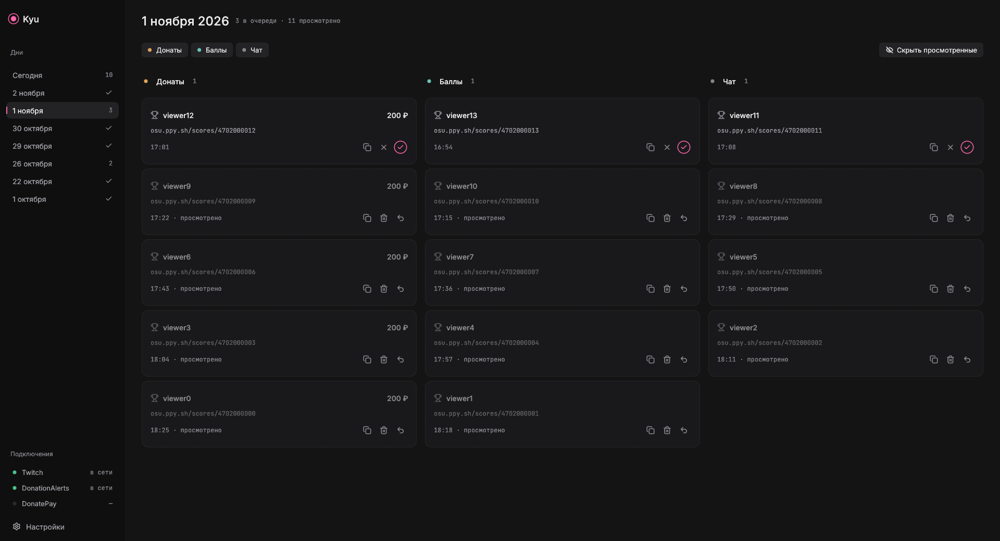
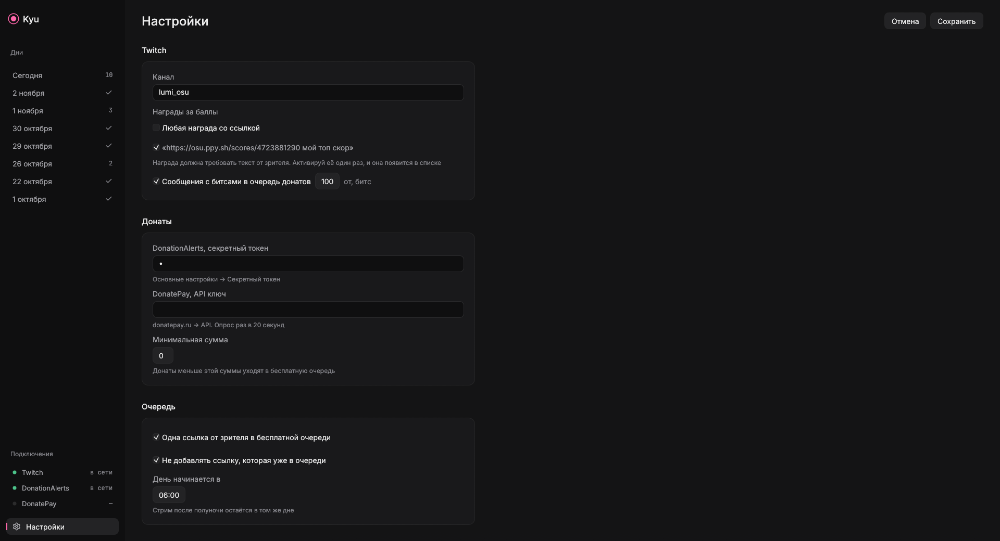

<p align="center"></p>

<h1 align="center">Kyu</h1>

<p align="center">Очередь скоров и профилей osu!, которые зрители присылают на стрим<br>
<a href="README.md">Read in English</a></p>



Kyu работает рядом со стримом и слушает. Зритель кидает ссылку на скор или профиль osu! в чат, активирует награду за баллы или прикладывает ссылку к донату, и она попадает в одну из трёх очередей. Открываешь, смотришь, отмечаешь.

## Что умеет

- **Три очереди.** Донаты (DonationAlerts, DonatePay и битсы), награды за баллы канала и обычный чат. Любую можно скрыть, например оставить на стриме только заказы за баллы.
- **Сам находит ссылки.** `osu.ppy.sh/scores/…`, `osu.ppy.sh/users/…` и `osu.ppy.sh/u/…`, с `https://` и без.
- **Хранит каждый день.** Каждый стрим-день лежит в отдельном файле. Через месяц можно открыть любой день и посмотреть, кого посмотрел, а кого пропустил.
- **По умолчанию ничего не удаляет.** В настройках можно включить «Удалять дни старше», по умолчанию 30 дней.
- **Граница дня настраивается.** День начинается в 06:00, так что стрим после полуночи остаётся в одном дне.
- **Защита от спама.** Одна ссылка от зрителя в бесплатной очереди и без повторов. Если кто-то задонатил ссылку, которая уже стоит в бесплатной очереди, она переезжает в платную, а не появляется дважды.
- **Ручное добавление** для ссылок из Discord и откуда угодно.
- Интерфейс на **русском и английском**.

| Прошлые дни | Настройки |
| --- | --- |
|  |  |

## Скачать

Последняя сборка в [Releases](https://github.com/sheynor43/kyu/releases/latest).

- **Windows:** `Kyu-1.0.0-windows-x64.exe`, один файл, без установки.
- **Linux:** `Kyu-1.0.0-x86_64.AppImage`, потом `chmod +x Kyu-*.AppImage` и запуск.

Windows SmartScreen может предупредить о неподписанном приложении. Нажми «Подробнее», затем «Выполнить в любом случае».

## Настройка

Открой **Настройки** слева внизу.

### Twitch

Впиши имя канала. Kyu читает чат анонимно, логин и OAuth-приложение не нужны.

Для **баллов канала** создай награду с включённым «Требуется ввод текста от зрителя». Twitch показывает в чате только награды с текстом, так Kyu их и видит. Активируй награду один раз сам, и она появится в настройках в разделе «Награды за баллы» с текстом, с которым её активировали. Отметь нужные награды или оставь «Любая награда со ссылкой».

**Битсы:** сообщения от N битс (по умолчанию 100) попадают в очередь донатов.

### DonationAlerts

Скопируй секретный токен в DonationAlerts: *Основные настройки → Секретный токен* и вставь в настройки. Чтобы проверить, отправь тестовое оповещение из панели DonationAlerts со ссылкой в сообщении.

### DonatePay

Создай API ключ на donatepay.ru в разделе API и вставь его. DonatePay разрешает один запрос в 20 секунд, поэтому донаты появляются с задержкой до 20 секунд. Донаты, пришедшие, пока Kyu был закрыт, подтянутся при следующем запуске.

### Минимальная сумма

Донаты меньше минимума попадают в бесплатную очередь, а не в платную.

## Где лежат данные

| Система | Папка |
| --- | --- |
| Windows | `%APPDATA%\kyu\data\` |
| Linux | `~/.local/share/kyu/` |

Каждый день лежит в `days/ГГГГ-ММ-ДД.json`, настройки в `settings.json`. Токены там хранятся открытым текстом, не выкладывай эту папку. Кнопка «Открыть папку с данными» в настройках ведёт туда.

## Сборка из исходников

Нужен Rust 1.85 или новее.

```sh
git clone https://github.com/sheynor43/kyu
cd kyu
cargo run --release
```

На Linux ещё нужны заголовки оконной системы, для Debian или Ubuntu: `libxkbcommon-dev libwayland-dev libxcb-render0-dev libxcb-shape0-dev libxcb-xfixes0-dev libgl1-mesa-dev`.

Тесты: `cargo test`. Проверки на живых серверах Twitch и DonationAlerts: `cargo test -- --ignored`.

Релизы собирает GitHub Actions на каждый тег `v*`, см. `.github/workflows/release.yml`.

## Благодарности

- Интерфейс на [egui](https://github.com/emilk/egui)
- Иконки [Lucide](https://lucide.dev) (ISC)
- Шрифты [Inter](https://rsms.me/inter/) и [JetBrains Mono](https://www.jetbrains.com/lp/mono/) (OFL)
- Дизайн сделан по правилам [unslop](https://github.com/heydamir/unslop) от Damir Sokolovsky (CC BY 4.0)

Kyu не связан с osu!, ppy Pty Ltd, Twitch, DonationAlerts и DonatePay.

## Лицензия

MIT
